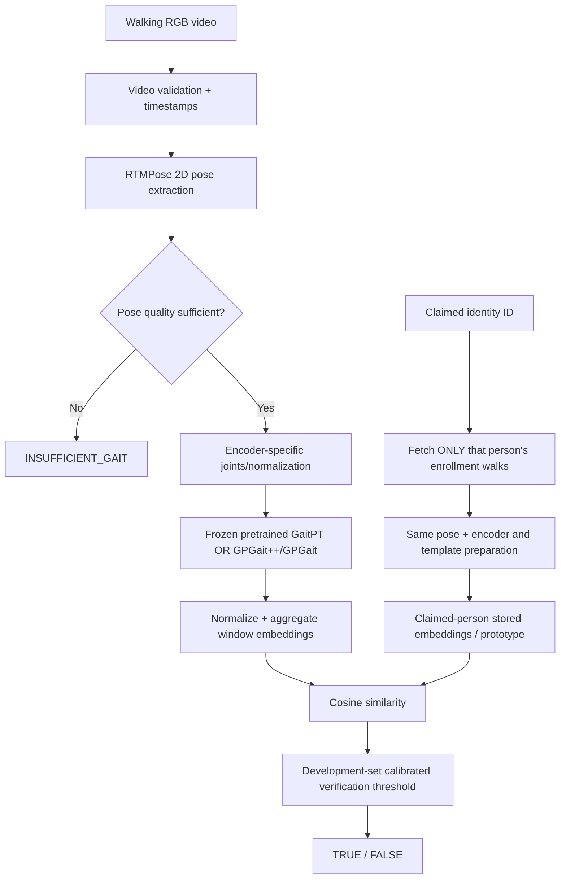

# Skeletal Gait Verification — Complete Project and Rearchitecture Handoff

**Version:** 3.0 | **Updated:** 12 October 2026  
**Audience:** Project teammates, supervisor, and coding agent  
**Companion implementation contract:** `GAIT_VERIFICATION_TECHNICAL_PRD.md`  
**Status:** New scope confirmed; recording and architecture-selection experiments are **planned**, not completed.

> **Read this first:** We are building a gait-based **claimed-identity verifier**, not a person identification system. Given a walking video and the claimed person's enrollment, it answers **TRUE** when gait sufficiently supports the claim, **FALSE** when it does not, or **INSUFFICIENT_GAIT** when the recording cannot support a reliable decision. It **never** searches for or reveals another person's identity. The recommended next architecture uses pretrained gait-specific skeleton encoders; **GaitPT is the first implementation, GPGait++/GPGait is the challenger, and our existing E0 temporal CNN remains the benchmark**. Nothing yet proves which will win on the new dataset.

---

## 1. Exactly what are we trying to achieve?

A person appears in an RGB walking video, and someone supplies an identity claim. We compare the observed person's walking skeleton against stored recordings of **that claimed person only**.

Example: **Abhishek is walking**, but the user claims **“this is Arhaan.”** The application looks up Arhaan's registered reference walks, extracts the walking skeleton from the query, and calculates whether the query is sufficiently similar to Arhaan's gait. A reliable mismatch leads to **FALSE — gait does not support the claimed identity**. It must **not** say “it is Abhishek,” list candidates, provide a ranked match, or search every identity to work out whose gait it is.

### Required behavior

| Video / claim situation | Appropriate result | Important interpretation |
|---|---|---|
| Arhaan walks; claimed identity is Arhaan; adequate match | `TRUE` | Evidence supports the claim at the chosen threshold; not absolute identity proof |
| Abhishek walks; claimed identity is Arhaan; adequate, low similarity | `FALSE` | Claim not supported; **do not identify Abhishek** |
| Unknown walker claims Arhaan; adequate, low similarity | `FALSE` | Same behavior; an exhaustive stranger gallery is unnecessary |
| Claim is not enrolled | `CLAIM_NOT_ENROLLED` / request enrollment | **Not** `FALSE`: there was no reference to compare |
| Feet are cropped, tracks fail, video is blurred or too brief | `INSUFFICIENT_GAIT` / recapture | **Not** `FALSE`: model lacks sufficient evidence |
| Video is usable but matching score is very near threshold | Either calibrated Boolean at declared operating threshold, or an optional non-Boolean review state if explicitly approved | Keep score/quality in internal audit log; do not claim certainty |

The **identity verdict** is Boolean whenever the video and claim are usable; error/abstention states are separate from the Boolean identity result. A strict API may return `{ "verdict": null, "status": "INSUFFICIENT_GAIT" }`; it must never silently map quality failure to `false`.

### What this does *not* do

- No **1:N identification**, best match, identity ranking, gallery-wide identity search, or “real walker” attribution.
- No “unknown person” **identification** module; a person claiming a wrong enrolled identity simply fails that single claim when reliable evidence allows it.
- No generic RGB deepfake detector. **A gait mismatch does not prove pixels were altered.** It may reflect a wrong label, actual impersonation, synthetic manipulation, pose error, view shift, or normal variation.
- No mandatory phone-side inference. GPU/laptop/server processing is fine; Android is the **recording device**.

**Change from the older handoff:** Older documents gave *equal priority* to 1:1 verification and 1:N identification and expected 13 or fewer local identities. Those statements are now **superseded by the project owner's latest decisions**: verification only; **approximately 40 participants** planned.

---

## 2. What exists today? Historical repository and original dataset

The 9 October 2026 repository audit (`CURRENT_ML_SYSTEM.md`, checkout revision `8ad340c`) recorded the following historical dataset and code behavior. These are **prior reported results**, not new measurements.

| Historical asset | Reported state |
|---|---|
| Independent people | **13** |
| Original walking videos | **66** (29 frontal, 37 side by filename categorization) |
| Augmented video derivatives | **1,056**; many share the same original take |
| Cached feature arrays | **1,120**; some duplicated original-derived features |
| Historical pose representation | 12 selected body joints from MediaPipe Pose Lite |
| Model inputs | 60 resampled time steps × **78 features** per query and reference |
| Core prediction architecture | Pairwise temporal Conv1D/CNN comparison head, about **133,058 parameters** |

### 2.1 The old pipeline, in plain English

1. Read an RGB walking video and estimate landmarks with MediaPipe.
2. Select 12 useful joints (shoulders, hips, knees, ankles, heels and foot/toe points).
3. Use hip-relative coordinates and joint angles; resample **detected** poses to 60 steps.
4. Produce 78 channels: 36 coordinates + six angles + 36 adjacent-coordinate differences.
5. Take a **query** sequence and an **enrolled reference** sequence.
6. Compute their differences and products and pass the resulting 234-channel temporal sequence through a compact Conv1D classifier.
7. Output a match/non-match score and apply a threshold.

**Important architectural correction:** Some legacy code registers a CNN, BiLSTM, Transformer, and identity verifier. Under the audited main prediction path, those auxiliary networks **do not provide the decisive verification logits**. Calling the original working model a trained CNN–BiLSTM–Transformer fusion system would be misleading. The supervised matching result comes from the compact pairwise temporal head.

The old time resampling uses indexes of *detected poses*, not actual physical timestamps. Therefore its adjacent differences are not necessarily physical velocity. This matters particularly for the proposed **moving-camera 30-second videos**.

### 2.2 Historical performance: the credible reference

| Historical controlled E0 metric | Recorded result |
|---|---:|
| ROC-AUC | **85.24%** |
| Equal Error Rate (EER) | **22.35%** |
| Genuine acceptance at 5% false acceptance (TAR @ FAR 5%) | **36.36%** |
| Side-view ROC-AUC | **88.01%** |
| Frontal-view ROC-AUC | **82.10%** |
| Historical 1:N Rank-1 | **40.40%**, **historical context only; no longer a project objective** |

These were obtained under a substantially improved historical controlled protocol compared with the legacy ~95% AUC figure, but only **13 people** were involved. Do not compare these numbers directly with metrics on 40 new participants as if only the model changed.

Other historical controlled verification AUCs: raw+frequency ~85.85%; raw+ST-GCN ~83.34%; raw+BiLSTM ~82.37% as stored (a precision/replay inconsistency was found); raw+Transformer ~81.86%; locally trained Siamese ~77.21%; basic DTW ~46.84%. A few engineered descriptors (extended angles and jerk) were interesting, but not established as consistently superior. RTMPose 2D ~85.90% was competitive with MediaPipe, **not confirmed to be the best on future data**.

### 2.3 What old experiments taught us

- Increasing local neural-network complexity did **not** clearly improve results when training on approximately 13 people.
- Pose quality, camera scale, viewpoint changes, missing legs/feet, and limited observation length can hurt results substantially.
- Identity evidence might come from **both body proportions and walking dynamics**; skeleton does not guarantee “pure motion” biometrics.
- Augmentation makes many *versions* of a recording, not new subjects or independent capture sessions.
- Test templates must not contain the same query recording or derivatives of it.
- Prior scripts have had protocol, model-branch, calibration, and rounded-score replay issues; we should build explicit regression and leakage tests.

**Keep E0 preserved** rather than deleting it to make room for a new architecture. It remains the required verification baseline.

---

## 3. What the two independent research investigations concluded

The first gait-focused Deep Research analyzed architecture families, source datasets, transfer learning, loss functions, metric embeddings, enrollment, and rigorously controlled testing. The second independently challenged its conclusions, checked implementation readiness, and corrected checkpoint assumptions.

### Where they agree

1. Train a large general identity representation on **external gait datasets**, rather than trying to learn it from our small local collection from scratch.
2. **Use published pretrained skeleton-gait models as frozen feature extractors first**. This can be implemented before our new data arrives.
3. **Keep E0** as a fair, code-verified baseline.
4. **GaitPT** is a practical first pretrained model to integrate because code and checkpoints are available.
5. **GPGait / GPGait++** deserve direct experimental comparison because cross-dataset pose transfer is their central research concern.
6. Carefully replicate the pretrained model's **joint order, coordinate frame, scaling, and temporal preprocessing**. A tensor with the right size but wrong meaning gives invalid results.
7. First test **zero local neural training**; later try a small adapter only when dev-set evidence supports it.
8. Choose the winner through the **same original recordings and verification trial protocol**, not by comparing incompatible academic benchmark percentages.

### What the second investigation corrected

- **GaitPT is not an empirically established universal winner.** It remains the simplest *first integration*, not a final decision.
- The official FastPoseGait project provides **GPGait++ model-download links**; its **training code remains flagged as unreleased**, so inference/reproducibility must be checked separately.
- A previously proposed fixed 256→128→256 adapter is a *hypothesis*, not a requirement. Derive output dimension `d` from the loaded encoder; start with a smaller `d→d/4→d` residual adapter if adaptation becomes necessary.
- Identity enrollment is not necessarily one irreversible average. **Keep the individual reference-walk embeddings**, and test simple pooling strategies.
- Claims about universal minimum recording counts or exact thresholds should not be presented as established facts.

### Changes required because the objective is now verification-only

Retain from that research: pretrained encoders, enrollment templates for the **claimed** person, pose-quality filtering, cosine matching, verification threshold, calibrated errors, frozen-transfer comparison, optional low-capacity adaptation, and subject-aware evaluation.

Remove from new-product scope: selecting a top identity across a gallery, Rank-1 as a target, top-1/top-2 margin, `UNKNOWN_PERSON` identity-search outputs, open-set identification calibration, and any “whose gait does it match?” endpoint. Some historical paper discussions may mention identification to explain the literature; they must not reappear as application requirements.

---

## 4. Our NEW planned dataset: 40 people, four 30-second views

**Current plan (not yet captured):**

| Item | Decision |
|---|---|
| People | **Approximately 40** consenting participants |
| Videos per person | **Four independent original recording files** |
| Duration | **30 seconds each**, target |
| Planned viewpoints | **45° left, 45° right, toward camera, away from camera** |
| Toward-camera recording | Subject walks forward while camera operator **walks backward** to maintain framing |
| Away-camera recording | Camera tracks subject from behind with operator moving as required |
| Device | Android RGB phone; **OnePlus 11R** is a known available candidate |
| Number of days | **Not established**; four recordings on one day may be the practical limit |
| Camera technique for 45° views | **Not established**: static versus moving camera needs a short pilot |
| Stabilization | No gimbal; compare original and controlled software-stabilized derivatives |

**Arithmetic:** 40 × 4 = **160 original videos**, with 160 × 30 seconds = **80 minutes of raw footage**. Frames and derived windows can be more numerous, but independent participants remain 40 and independent video takes remain 160.

### 4.1 What this improves

Forty independent identities are **materially better than 13** for studying between-person gait variation. A 30-second video also provides more observable walking cycles, when the walker remains visible and moving, and can be divided into multiple pose windows for quality-weighted averaging.

### 4.2 What it does NOT solve

**If each person is recorded only once per view on one day, there is no genuinely independent different-day session for that identity.** A model that succeeds when enrollment is an oblique camera angle and the query is frontal/away has shown some *different-take / cross-view robustness*, **not multi-day cross-session reliability**. Segments from the same 30-second take cannot be placed across train and test and called independent observations.

Camera motion may introduce **phone-operator motion**, rolling-shutter distortion, image blur, reframing and joint motion unrelated to the walker. This makes capture stability and experimental design important.

### 4.3 Recommended pilot before filming all 40

Record short tests with **2–3 volunteers**, using each planned view and the actual phone. Do NOT treat the pilot people as independent final-test evidence if they influence design decisions.

Check:

- Does the whole person, including both feet, remain visible for most of each 30-second video?
- Can the operator maintain a stable distance without sudden stops, turns or unsafe backward walking? Use a spotter/clear path; a fixed camera is safer and often scientifically cleaner.
- Does the 45° specification refer to the **camera-to-walking-direction angle**, consistently on both sides?
- Does the subject remain large enough for reliable ankle/heel/toe tracking? Avoid extreme wide-angle distortion and tiny subjects.
- Does the stock camera mode crop excessively or change frame rate? Confirm actual file properties with `ffprobe`.
- How do raw, mildly stabilized, and gyro-assisted candidates compare on foot visibility, continuity, and inferred joint movement?

**Recommendation:** prefer several distinct original takes and clear view labeling over elaborate per-video augmentation. If a **second recording day** becomes possible for at least a subset, it would be especially valuable as an external session-transfer stress test; do not claim it exists unless filmed.

### 4.4 Folder and split discipline

Example **conceptual** organization (not a claim about current repository paths):

```text
data/new_raw/S001/V01_left45/take01.mp4
               /V02_right45/take01.mp4
               /V03_toward/take01.mp4
               /V04_away/take01.mp4

data/new_processed/S001/V03_toward/take01_vidstab_v1.mp4
manifests/recordings.csv
manifests/split_v1.json
```

Keep actual names/identities in a restricted consent mapping; use anonymous `S001` etc. Never overwrite a source video with a stabilized copy. Stabilization, resizing and other derived files must point back to one **parent original take** and stay in its data split.

### 4.5 Evaluation when there are four original views per person

For an honest *preliminary* design, use one entire original view as a probe and one or more **different original views** as that person's enrollment, rotating across the four views. This is **different-take, view-held-out** verification, not independent-day testing. Avoid selecting enrollment or evaluation windows from different parts of the same source file.

For architecture selection and thresholds, partition **subjects** into development, threshold-calibration, and locked-final groups (e.g. **24/8/8**, an example rather than a scientifically mandated number). The final group may contribute *reference takes for enrollment* during testing, but must not contribute data to train or choose the gait backbone/adapter, choose thresholds, optimize stabilization, or select the architecture. With 40 participants, uncertainty remains nontrivial and should be reported.

Each query's label is defined relative to the single **claimed** person: a genuine claim uses that query person's claimed enrollment; an impostor claim uses an enrollment for **another** subject. Balance or explicitly document impostor-claim selection. Report performance per **source clip and subject**, not as though hundreds of overlapping windows or all generated pairs were independent.

---

## 5. Camera stabilization: research-backed decision

### 5.1 EIS, OIS, and post-processing are different

- **OIS (optical):** hardware lens/sensor motion reduces camera shake during capture. The OnePlus 11R main rear camera officially supports OIS.
- **EIS (electronic):** camera pipeline digitally shifts/crops frames, often with motion sensing, during recording. OnePlus officially lists EIS/OIS video stabilization and Super Stable, but the exact stabilization behavior depends on recording mode and is **not proven optimal** for our use.
- **Post-processing digital stabilization:** software estimates camera motion from video frames or synchronized gyro data and then warps/crops a copy. Crucially, you can retain the raw original and decide later whether processing helps.

**Post-stabilization cannot restore blurred feet, missing joints, occlusion, or depth parallax.** It can even introduce extra resampling, body deformation and edge crops. Our primary goal is **stable 2D pose tracking and accurate verification**, not aesthetically smooth cinema footage.

### 5.2 Options we researched

| Method | Advantages | Limitations | Project recommendation |
|---|---|---|---|
| OnePlus 11R main-camera **OIS**, normal video | No separate render workflow; main sensor OIS and quality available | May still have shake or stock processing; OIS not universally user-toggleable | **Preferred practical starting capture**, preserve original |
| OnePlus **Super Stable / EIS** | Quick phone-only recording | Can crop, warp and alter effective FOV; mode-dependent; previous personal test was disappointing | **Pilot comparison only**, do not force for entire dataset |
| **FFmpeg `vid.stab`** | Free, two-pass, repeatable CLI, Linux-friendly, batch reproducibility | Global motion may be biased by large moving person; crop and translation artifacts | **Preferred reproducible post-processing A/B candidate** |
| **Shotcut** video Stabilize filter | Free GUI built on `vid.stab`; accessible on Linux | Manual job/export overhead | Good visual/user-friendly version of the FFmpeg trial |
| **DaVinci Resolve Free** Stabilization | Rich manual controls: smoothing, strength, crop ratio, camera lock | Workflow/version/codec support differs across systems; less reproducible for 160 files unless scripted/export settings logged | **Strong manual QA or difficult-clip alternative** |
| **Google Photos** Stabilize | Convenient Android one-tap post-processing | Opaque, app-specific parameters; difficult to enforce one uniform research transform | Quick visual comparison, **not primary dataset processor** |
| **Gyroflow** | Gyro-based correction, lens/rolling-shutter correction, adaptive zoom | Standard OnePlus 11R video not confirmed to carry usable gyro metadata; may require logging, calibration, sync, and disabling unmodeled OIS | **Optional advanced pilot**, not assumed plug-and-play |

### 5.3 Recommended default process

1. **Record** with the rear main 1× camera where practical, keep full body/feet with generous crop margin; use consistent lighting and exposure. The OnePlus 11R officially supports 1080p and 4K at 30/60 fps, but test resolution/fps/stabilization combinations on the device rather than presuming all modes behave identically.
2. **Retain and hash the original** video, do not use automatic cloud edits as the sole saved artifact.
3. On a short pilot, compare **original/unmodified**, **mild FFmpeg vid.stab**, and **DaVinci Resolve Stabilization** if desired. Include stock Super Stable as a separate capture condition only if you can acquire a comparable take.
4. Check **foot visibility, missing keypoint fraction, pose jitter, skeleton bone-length variation, track continuity, temporal frame behavior, crop amount, and view-specific subject motion**. Apply the same pretrained model and verification development protocol to raw versus stabilized data.
5. **Select stabilization settings using development samples only**, and freeze the recipe before final test. It's legitimate if **raw wins**. Do not stabilize only hard examples chosen after viewing ground-truth match labels.

**Recommended engineering rule:** the raw branch is the primary reproducibility baseline. The stabilized branch is a **controlled ablation**, not an obligatory preprocessing step. If a fixed production rule is adopted, apply it consistently to both query and enrollment or test mismatched cases explicitly; do not let different pipelines silently encode subject identity.

### 5.4 Gyroflow caveat: why it is not the immediate default

Gyroflow uses camera motion readings; it must know the sensor/lens convention, image–gyro time offset and relevant rolling-shutter parameters. Its official supported sources include Android companion apps such as Sensor Logger, Sensor Record, OpenCamera Sensors and MotionCam Pro. **That does not establish OnePlus stock videos directly contain compatible gyro metadata.** Moreover, some workflows cannot correctly use gyro-only stabilization while unmodeled OIS moves the camera lens; whether OnePlus allows a clean capture mode needs validation. Only use Gyroflow if a test shot proves reliable synchronization, lens calibration, and stable anatomically plausible skeleton tracks.

### 5.5 Example Linux processing for a short development clip

Check that your FFmpeg has the required two filters:

```bash
ffmpeg -filters | grep vidstab
```

First pass (run in a per-video working directory):

```bash
ffmpeg -hide_banner -i raw.mp4 -vf "vidstabdetect=shakiness=5:accuracy=15:result=transforms.trf" -an -f null -
```

Second pass (conservative **candidate** smoothing, not a scientifically optimal setting):

```bash
ffmpeg -hide_banner -i raw.mp4 \
  -vf "vidstabtransform=input=transforms.trf:smoothing=15:optzoom=1" \
  -c:v libx264 -crf 17 -preset medium -pix_fmt yuv420p -an stabilized.mp4
```

Do not frame-rate-convert, trim, or reorder frames between the two passes: the `vid.stab` transform sequence expects corresponding source frames. Record versions, source hash, flags, output hash, crop/quality findings and timestamp handling. Avoid aggressively sharpening or interpolating frames as a default because that could affect pose extraction.

### Sources for the stabilization research

- Official OnePlus 11R specs: https://www.oneplus.in/11r/specs
- Official `vid.stab` README and FFmpeg recipe: https://github.com/georgmartius/vid.stab
- Shotcut stabilization documentation: https://shotcut.org/stockmedia/Shotcut%20User%20Guide.pdf
- Blackmagic Design, DaVinci Resolve stabilization: https://www.blackmagicdesign.com/in/products/davinciresolve/edit
- Google Photos video stabilization instructions: https://support.google.com/photos/answer/10729480?co=GENIE.PlatformAndroid&hl=en
- Gyroflow project and supported sensor sources: https://github.com/gyroflow/gyroflow
- Gyroflow synchronization and lens requirements: https://github.com/gyroflow/docs.gyroflow.xyz/blob/main/getting-started/basic-usage/README.md

---

## 6. Complete new architecture (verification-only)



### 6.1 Pose extraction

Run a frozen 2D human pose estimator on the recorded frames. Cache frame index, original timestamp, 2D joint coordinates, confidence, model hash, visibility/missing flags and camera metadata. RTMPose is the **initial** candidate. Keep MediaPipe as a historical control. A model that produces a visually better skeleton is not necessarily a better gait-verification feature extractor: compare both under the same matcher on development data.

**Do not feed the legacy 78-channel vector directly into GaitPT/GPGait.** Pretrained models have their own skeletal joint set, dimensions, normalization and temporal sampling. Incompatibility can invalidate the entire experiment even if a forward pass succeeds.

### 6.2 Frozen pretrained gait encoder

The gait model represents each observed walking sequence as a relatively compact numerical **embedding**. It should place comparable walking patterns near each other in representation space. On the first pass, do **not** train it on the local participants.

- **First to integrate:** GaitPT (hierarchical skeleton Transformer); start by testing available pretrained GREW checkpoint, then compare other official available source checkpoints on development data.
- **Direct challenger:** GPGait++ (cross-domain human-oriented pose gait); fall back to GPGait where integration/checkpoints are not reproducible.
- **Other researched, later-stage candidates:** GaitGraph2, GaitMixer/GaitFormer, SkeletonGait, GaitHeat and MotionBERT. They are not required to implement the first end-to-end milestone.

Some source papers report a **256-dimensional** GaitPT representation and around **4M** backbone parameters. The second independent review advises reading actual checkpoint/config **rather than hard-coding** these numbers blindly. The new API must infer and assert embedding dimension `d`.

### 6.3 Multi-window and enrollment representation

A 30-second recording can be divided into multiple valid **windows** matching each model's training input requirements. Combine those window embeddings into **one walk-level representation**, optionally weighting for predetermined tracking/visibility quality.

For the claimed person, store **several independent original walk embeddings** instead of destroying them in one averaged vector. Start with a normalized centroid of the available enrollments, then compare nearest-template or mean-top-k **only if these are chosen/calibrated on development data**. With only four views, preserve per-view information. Avoid a gallery-wide model or search logic; the matcher receives just the **claimed identity's** templates.

### 6.4 Compare claimed gait, not all enrolled identities

Normalize the query embedding `zq` and claimed enrollment template `zc`, then compute **cosine similarity**. A development-set threshold decides whether the score sufficiently supports the claim. These similarities are not automatically probabilities; optional logistic calibration requires held-out development claims.

If several enrollment templates are used, aggregation rule, enrollment-shot count, and score threshold must be calibrated together; taking a maximum over templates changes the impostor-score distribution even without a 1:N identity search.

### 6.5 Quality / abstention

Treat **INSUFFICIENT_GAIT** as a legitimate outcome when there is no usable skeleton, the body or feet are persistently cropped, large portions of movement are missing, tracking swaps persons, or too few valid sequence windows survive. This avoids confusing pose failures with evidence that a claimed identity is wrong.

### 6.6 Optional adapter — only after frozen transfer

If both source-pretrained encoders suffer domain mismatch (e.g. OnePlus camera/pose conventions), test a **small residual adapter** on top of the frozen embedding, starting with bottleneck width roughly `d/4`. The adapter is an experiment, not the starting requirement. Train only on development subjects and evaluate on identities **never used to train** the adapter. Prototypical/metric loss or a pairwise verification objective can be tested as prespecified ablations; do not simultaneously tune many losses and architectures on the tiny dataset. Do not fully fine-tune a multimillion-parameter encoder by default.

### 6.7 Why verification-only is easier than our previous plan

We no longer need to decide whether a query gait is closest to Arhaan, Abhishek, or someone else, manage identity ranking, fit an independent open-set identification threshold, or produce a “who is it” response. The application stores enrollment references but retrieves **one identity's templates** per request. This reduces code scope, privacy exposure and number of evaluation targets. It does **not** eliminate the difficult work of separating genuine versus impostor claims under view/camera variation.

---

## 7. What we must measure, and what counts as an honest improvement

**The key research experiment is verification-only:** E0 pairwise CNN **vs** frozen GaitPT **vs** frozen GPGait++/GPGait, using the **same claimed-identity trial list**, held-out identities where applicable, and comparable recorded conditions. Each encoder uses its **correct native preprocessing**, while the split and trial definitions stay identical.

| Metric | Meaning | Priority |
|---|---|---|
| **EER** | False acceptance and false rejection intersect | Primary verification characterization |
| **TAR at FAR=5%** | Fraction of genuine claims accepted while false acceptance is held to an evaluated level | Primary operating-point measure; small-sample uncertainty important |
| **ROC-AUC** | Genuine versus impostor score ranking | Secondary threshold-free measure |
| FAR and FRR at **frozen development threshold** | Actual deployment-like errors | Essential primary test report |
| False-negative and false-positive counts by subject/view | Reveals whom and which angles fail | Essential diagnostic |
| **Coverage / abstention rate** | How often the system can even issue TRUE/FALSE | Essential; never drop failures silently |
| Original vs stabilized performance | Whether software stabilization helps pose and verification | Controlled preprocessing experiment |
| Runtime, peak GPU memory | Practical server/laptop feasibility | Engineering metric |

**No longer project metrics:** Rank-1 accuracy, CMC curves, top-k identity retrieval, unknown-person search error, and open-set identification margins. Mention them only as historical research context.

### Correct experimental logic

- Each of the ~40 subjects may be both a **genuine** query and a **wrong-claim (impostor)** query against another participant's templates.
- Train E0 and any adapter on **development identities**, not test identities. Pretrained encoders are frozen initially.
- Select pretrained checkpoint, stabilization, template rule, pose estimator and threshold **only on development/calibration participants**.
- Keep the locked participant group untouched until all selections are frozen.
- At test, a new identity can contribute reference enrollment videos, but their probe videos must be distinct originals and cannot have influenced training/selection.
- Never mix frame windows or stabilized/augmented versions of one source take across train/test.
- Cluster confidence intervals by **subject** (and session when available), not by all generated scores/windows.
- Because camera/view settings are limited and single-day filming may be unavoidable, label results **cross-view/different-take pilot evidence**, not general long-term biometric security performance.

A useful failure diagnosis is to compare verification across **each held-out probe view** (left45, right45, toward, away), and report any camera-motion effect. Also run one controlled “static posture / temporal shuffle” diagnostic to determine whether the model relies mainly on body shape rather than dynamic walking.

---

## 8. What can be coded *before* the new recordings arrive?

**Most of it.** The recommended development approach is implementation first, measurements later.

### Phase 0 — Start immediately (without new data)

1. Create a new development branch, preserve existing E0 checkpoints/reports and record current Git revision.
2. Verify GaitPT pretrained checkpoint, source code, permitted use and input contract; run a forward-pass smoke test on documented sample tensors/source data.
3. Investigate/verify GPGait++ frozen inference using official FastPoseGait files; fall back to GPGait if ++ cannot be loaded reproducibly.
4. Implement a common backend interface (`encode_sequence → embedding`) that handles **each backbone's native preprocessing**.
5. Implement video ingestion, timestamp-preserving pose extraction/caching, confidence/quality gating, identity-specific enrollment templates, and claimed-identity comparison.
6. Implement a **verification-only** evaluator for EER, TAR@FAR, ROC-AUC, frozen thresholds, subject-cluster uncertainty and coverage.
7. Add raw/stabilized variant linking and a pilot processing option; no stabilization outcome selected yet.
8. Test with **existing 13-person data** as engineering/development smoke data, clearly marked exploratory. Do not present their results as final new-cohort evaluation.

### Phase 1 — Short camera pilot

Try the four angles, raw/OIS capture and mild post-stabilization alternatives. Review pose tracking, FPS/timestamps, camera-motion confounds and crop. Freeze recording guidance before mass collection.

### Phase 2 — Collect new videos

Collect approximately 160 true original videos, create a consent-backed pseudonymous capture manifest, verify file checksums, and process **without overwriting originals**. Record whether there are one or multiple filming days.

### Phase 3 — Pretrained zero-shot comparison

Run frozen GaitPT and frozen GPGait++/GPGait using the defined **verification-only** subject/take trial manifest and claimed-identity enrollment. Re-establish E0 on the new split. Assess views, quality and thresholds without training the new pretrained backbones.

### Phase 4 — Controlled improvements

Only if needed, change **one variable at a time**: pose extractor; enrollment aggregation; mild raw versus post-stabilized preprocessing; adapter; limited hand-engineered motion features. Select using development data and prespecified metrics.

### Phase 5 — Locked final evaluation

Freeze model, preprocessing, enrollment rule, subject splits, thresholds, quality policy and checkpoint hashes; evaluate final participants once. Write a transparent report including failures and uncertainty. Avoid claiming the selected model generalizes across unseen days if all video was filmed on one day.

---

## 9. Technical and ethical safeguards

- Obtain meaningful informed consent for **biometric gait collection**. Use pseudonymous subject IDs, restrict name↔ID mapping, encrypt data where practical, and document retention/deletion plans.
- Keep original recordings, camera settings, pose caches, stabilization parameters, encoder checkpoints and scores linked by hashes and exact source-take IDs.
- Avoid publishing recognizable participant footage or biometric embeddings without explicit permission.
- Fix template provenance and train/test split leak checks before reporting performance.
- Preserve model licenses; GaitPT and FastPoseGait carry academic/noncommercial restrictions that need review before any external deployment.
- Do not tell anyone that a rejected identity claim proves a deepfake or deliberate fraud.
- Any camera operator walking backward must have a safe route and ideally a spotter; a stable stationary-phone setup is safer when practical.

---

## 10. Project decisions and uncertainties

| Item | Status as of 12 October 2026 |
|---|---|
| Primary and only identity task | **CONFIRMED: 1:1 claimed-identity TRUE/FALSE verification** |
| Person identification / ranked search | **REMOVED from scope** |
| Bad-video result | **REQUIRED engineering guard: INSUFFICIENT_GAIT** |
| New dataset | **PLANNED: ~40 people × four ~30 s originals, ~160 total** |
| Four angles | **PLANNED: 45° left, 45° right, walking toward, walking away** |
| Moving phone for toward/away | **PLANNED**, with camera-motion risk |
| Recording days and 45° camera motion | **NOT YET CONFIRMED** |
| Camera stabilizer | **NO GIMBAL**; original+software variants to test |
| First pretrained model | **RECOMMENDED: frozen GaitPT** |
| Main pretrained challenger | **RECOMMENDED: frozen GPGait++ / GPGait** |
| Existing baseline | **REQUIRED: preserve and reevaluate E0** |
| Raw vs stabilized winner | **UNKNOWN; empirical comparison required** |
| Final architecture winner | **UNKNOWN; decide using code and held-out metrics** |
| Adapter / backbone fine-tuning | **NOT AUTHORIZED BY DEFAULT; later conditional experiment** |

---

## 11. Where does each document fit, and how does the coding agent retain context?

Put **both** this file and `GAIT_VERIFICATION_TECHNICAL_PRD.md` into your repository, preferably under `docs/gait_verification/`. The companion **PRD is the normative technical implementation contract**. This handoff is the explanation of what we already know and why we chose the approach. Both are required context for new **gait architecture, capture, preprocessing, verification and evaluation tasks**.

For **Codex**, add a small repository-root `AGENTS.md` that points to the two documents. Codex loads relevant `AGENTS.md` instructions automatically in its repository workflow. For **Claude Code**, put an equivalent pointer in `CLAUDE.md`. This helps across coding sessions, but is **not a technical guarantee that an agent will reread every word before every trivial action**. The most reliable practice for a substantial gait-related task is to explicitly say: “Read both docs, state the constraints and scope, then implement Phase N; stop if there is a contradiction.” Templates are provided in the PRD.

If using a regular chat or Work conversation without persistent repository files, attach or otherwise make both documents accessible **in that specific working context** and reiterate the same short instruction in each new working conversation. Files cannot be assumed available across unrelated chats or agents.

---

## 12. Essential academic references and authoritative source links

**Internal basis (historical and previously delivered research):**

- `CURRENT_ML_SYSTEM.md` — 9 October 2026 repository audit; 13-subject original corpus and controlled experiments.
- `PLANNED_ML_SYSTEM.md` — older full project plan, superseded wherever it required 1:N identification or ≤13 new participants.
- `deep-research-report (1).md` — first correct architecture research report, GaitPT-first proposal.
- `Independent Reassessment and Final Architecture Selection for Small-Data Skeletal Gait Biometrics` — second report, GPGait++ checkpoint-status correction.
- `GAIT_ML_COMPLETE_TEAM_HANDOFF.md` — previous handoff, now superseded for current scope.

**Papers and official code:**

- GaitPT, *Skeletons Are All You Need for Gait Recognition* (FG 2024), DOI: https://doi.org/10.1109/FG59268.2024.10581947 ; code: https://github.com/UbiquitousCognitiveSystems/GaitPT
- GPGait, *Generalized Pose-based Gait Recognition* (ICCV 2023), DOI: https://doi.org/10.1109/ICCV51070.2023.01795 ; FastPoseGait: https://github.com/BNU-IVC/FastPoseGait
- GPGait++, *From FastPoseGait to GPGait++* (TPAMI 2025), DOI: https://doi.org/10.1109/TPAMI.2025.3577594
- GaitGraph2, https://arxiv.org/abs/2204.07855
- SkeletonGait, https://doi.org/10.1609/aaai.v38i2.27933
- Cosma et al., *On Model and Data Scaling for Skeleton-based Self-Supervised Gait Recognition* (AAAI 2026), DOI: https://doi.org/10.1609/aaai.v40i5.37340
- MMPose / RTMPose: https://github.com/open-mmlab/mmpose
- Metric-learning reference: *Prototypical Networks for Few-shot Learning*, https://arxiv.org/abs/1703.05175

**Source-status caution:** published checkpoint access and repository release notes can change; implementation must verify actual weight files, loading behavior, licenses, and tensor shape rather than trusting summary descriptions.

---

## 13. Final teammate briefing

Our original project compared walking skeletons from a tiny 13-person collection with a small temporal CNN. Many larger architectures were tried, but none convincingly beat the controlled baseline; the historical model itself was more modest than its registered CNN/BiLSTM/Transformer wrapper implied.

We are now planning **40 people × four 30-second views** and have narrowed the task to **one question only**: “Does the observed walking gait match the claimed enrolled identity?” The system must say **TRUE or FALSE when evidence is sufficient**, and **INSUFFICIENT_GAIT** when video quality makes the comparison unreliable. It must **never identify someone else**.

Two independent literature reviews recommend trying **pretrained pose-based gait embeddings** without local retraining. We'll code GaitPT first, compare GPGait++/GPGait, and retain E0 as the benchmark. We can implement pose extraction, checkpoint adapters, claim-specific template comparison, and evaluation **now**, using old videos for smoke tests. The 40-person recordings will later decide whether the new models actually work. Meanwhile, **do not bake in stabilization**: preserve original OnePlus videos and compare mild reproducible post-stabilization against raw using skeleton quality and verification results.

**Next action for the coding team:** Open `GAIT_VERIFICATION_TECHNICAL_PRD.md`, complete the no-training Phase 0 checklist, and run a short camera/stabilization pilot before filming all 40 participants.


## Phase 0 amendment — 12 October 2026

Owner's explicit Phase 0 request supersedes the starter example in §5.5: detection
`shakiness=5:accuracy=15:mincontrast=0.2`; transform
`smoothing=10:optzoom=0:crop=black:interpol=bicubic`. Smoothing 15 remains a
separate experimental variant with the same no-zoom settings. Raw remains the
control. The example above is preserved as historical context, not active config.

Current official FastPoseGait revision `d3ce631971a01d806eeb3a154774d482c0951813`
now includes `GPGait_PlusPlus` source and a checked training-code release item.
Earlier statements here that training code is unreleased are superseded by this
source observation; checkpoint compatibility is a separate gate. See
[Phase 0 implementation report](PHASE_0_IMPLEMENTATION_REPORT.md) for executed
tests, checkpoint hashes, licensing restrictions and remaining blockers.
Author: Codex, implementing the owner's Phase 0 instruction; affected modules:
V2 stabilization config/runner, model audit. No final model or threshold selected.

## Phase 1A amendment — 12 October 2026

Owner now assigns independent Phase 0 engineering verification, followed directly
by Phase 1A RTMPose/runtime validation, temporal-window quality, paired RAW/S10/S15
comparison and a student capture SOP draft. This phase excludes GPGait++ work,
training, fitting and threshold selection. Working inference is engineering evidence;
the future 40-person cohort, four-view moving-camera pilot and biometric validation
are separate dependencies. Final SOP freezing remains conditional on actual pilot
recordings, rather than required by this implementation-only milestone.

A real audit found native RTMPose SimCC scores above one: preserve their values,
not clipped probabilities. Temporal diagnostics retain missingness and all native
candidate observations, while only unchanged fully observed contiguous segments
reach encoders. Uncertain person tracks cannot be pooled. The previous all-frame
gate remains available, and the new window path is opt-in with a versioned recipe.
The API keeps the PRD's `CLAIM_NOT_ENROLLED` naming for conceptual `NOT_ENROLLED`;
all non-decisions have a null verdict. No identification is introduced.

The actual RAW/S10/S15 measurements on two short historical originals show no
basis for promoting stabilization. They do not establish moving-camera performance
or verification accuracy. See [Phase 1A report](PHASE_1A_CAPTURE_PILOT_REPORT.md)
and [capture SOP draft](CAPTURE_SOP_DRAFT.md). Author: Codex; affected modules are
V2 pose/cache/quality, opt-in aggregation, pilot runner, CUDA validation and docs.
Historical E0, checkpoints and original videos are preserved.

## Phase 1B amendment — 12 October 2026

Codex began Phase 1B model integration, and Claude Code completed it after Codex
ran out of usage. All four frozen pretrained candidates now load strictly and run
repeatable CUDA inference on a real RTMPose cache: GaitPT-GREW (256-D),
GPGait-GREW, GPGait++ GREW and GPGait++ CASIA-B (4,864-D each). The official
GPGait++ GREW checkpoint (1,308,128,306 bytes, SHA `eb37d274…`, all ZIP CRCs
verified) is safely reduced to model-only weights without unrestricted
deserialization.

This supersedes earlier statements that GPGait++ weights could not be loaded.
CASIA-B GPGait++ is an engineering ablation, not a matched GREW comparator.
Successful inference is not recognition evidence. No winner, threshold or
calibration was chosen, and E0 is unchanged. See the
[Phase 1B report](PHASE_1B_MODEL_INTEGRATION_REPORT.md).


## Phase 1C amendment — 12 October 2026

Claude Code completed enrollment and the real `(video, claimed_id)` path: per-original
reference storage (atomic, private-by-permission, not encrypted), claim-only lookup,
cosine scoring against the claimed subject's prototype, recipe and original-take
leakage checks, and an end-to-end CUDA run for all four frozen candidates. No threshold
exists, so usable enrolled claims return `POLICY_NOT_READY` with a null verdict; raw
scores are restricted diagnostics. This is engineering only: no accuracy, model winner
or threshold is claimed, and the four-view pilot and 40-person cohort are still pending.
See the [Phase 1C report](PHASE_1C_ENROLLMENT_VERIFICATION_REPORT.md).

## Phase 1D amendment — 12 October 2026

Claude Code built the evaluation framework that the future cohort will use: a capture
registry that resolves every managed-study file by its actual checksum to its original
take (so a stabilized copy of an enrolled original is refused even when nobody declares
it), subject-level split manifests with a lock and a locked-test authorization guard,
deterministic genuine/impostor trial manifests, batch enrollment and query ingestion, and a
restricted offline evaluator with coverage, ROC/EER/TAR, subject-cluster bootstrap and
paired model comparisons. An edited copy that was never registered still cannot be traced
by bytes; the managed workflow refuses it rather than treating it as new. Split counts,
impostor sampling and the target FAR remain owner decisions. All metrics so far come from
synthetic fixtures: no accuracy, threshold, calibration or model winner exists, and E0 is
unchanged. See the [Phase 1D report](PHASE_1D_EVALUATION_FRAMEWORK_REPORT.md).

## Phase 2 owner-decision amendment — 12 October 2026

Physical collection and empirical validation are deferred until completion of the software architecture. Engineering work may proceed using clearly labeled test fixtures. Scientific and deployment readiness remain blocked. All deferred recordings, owner decisions, scientific validations and security items are tracked in [DEFERRED_EVIDENCE_AND_DECISIONS.md](DEFERRED_EVIDENCE_AND_DECISIONS.md). Earlier scope descriptions above are preserved unchanged.

## Phase 2 engineering continuation — 12 October 2026

Claude Code built the dataset-processing architecture; Codex recovered its exact
uncommitted worktree, reproduced the committed Phase 1D baseline and independently
verified/fixed ingestion, deterministic planning, cache integrity, recovery, CUDA
resource controls and derivative provenance. Phase 2 engineering is complete. The
[implementation report](PHASE_2_DATASET_INTEGRATION_REPORT.md) records the final checks,
36 additional regression cases, preserved prior CUDA smoke and next proposed software
slice. The [operator guide](PHASE_2_OPERATOR_GUIDE.md) matches the CLI, and IMP-01…IMP-10
are DONE in the [deferred register](DEFERRED_EVIDENCE_AND_DECISIONS.md).

This completes software engineering only. The owner's collection deferral is preserved:
no new pilot/cohort, scientific validation, training, threshold, model winner or locked-final
study occurred. All four candidates remain BLOCKED for deployment and E0 is unchanged.
Unsealed Phase 1D query records remain explicitly compatible; new processing records
require integrity checks. Checksums are not authenticated/encrypted storage. Physical
collection follows completion of the agreed architecture, rather than being requested
as the next prerequisite for further software work.

## Phase 2B frozen E0/common-trial amendment — 12 October 2026

Author: Codex, following the owner's architecture-only Phase 2B assignment. Existing
weights are frozen; this phase does not authorize the earlier roadmap's new-cohort
E0 retraining, calibration, collection or model selection.

The controlled LOSO E0 bundle is absent, but the shipped wrapper contains the exact
133,058-parameter temporal head and its feature statistics. Safe hash-pinned static
extraction plus unchanged restricted loading preserves those decisive tensors.
The integrated baseline is explicitly `historical-local-13-subject-shipped`; old
controlled metrics are not reproduced by labeling those different weights E0.

Native MediaPipe33 heel/toe/xyz features remain separate from pretrained RTMPose
skeleton inputs. Detected-index resampling, hip-relative coordinates, six angles,
last-row difference padding and checkpoint z-scoring remain historical. A versioned
mean reference-feature signature scores only the supplied claim; logit margin is
uncalibrated. Neither legacy identity search nor historical thresholds are imported.

The existing trial runner and Phase 2 integrity/source/split controls now support
E0 and pretrained runs on one manifest. An explicit architecture comparison permits
the audited E0-versus-GREW training regimes while keeping the default matched guard;
training populations differ and causal superiority claims are unsupported. CASIA-B
remains a separate ablation; raw score scales are never combined. Full coverage,
pairwise subsets and an all-primary scoreable intersection are reported separately.
Successful inference remains POLICY_NOT_READY with null verdict; all candidates,
including E0, stay research-only/deployment blocked. The
[Phase 2B report](PHASE_2B_E0_INTEGRATION_REPORT.md) records actual tests, parity,
checkpoint distinction, quality/security limits and the next architecture-only audit.

## Phase 2C independent architecture audit amendment — 13 October 2026

Author: Codex. An adversarial review reproduced engineering defects beyond the passing
Phase 2B tests: protected-data paths in older embedding/verification entry points,
direct-scorer ownership/role omissions, split-transition loopholes, mutable trial policy,
linked ledger writes, stale source/variant records and invalid report contracts. Bounded
corrections strengthen the existing architecture; they do not change E0 feature semantics,
scientific sampling, model selection or the owner's collection deferral.

Managed verification now needs `--data-root` and `--split`; `embed` needs `--split`;
pretrained scoring also needs `--data-root`. New v3 trial manifests bind policy/counts/
headers as well as unchanged trial rows, and reproduce the existing generator. Old v2
archives are preserved and refused for managed use until regenerated into new files from
the same explicit inputs. Claim lookup precedes CUDA loading. All successful uncalibrated
scores still return `POLICY_NOT_READY`, null verdict, without another-person disclosure.

New private pose/derivative artifacts, safe ledger handling, source/ancestry/ownership
checks and report validation have regression evidence. E0 CUDA dispatch holds the shared
cooperative slot; comparisons disclose the minimal MediaPipe gate versus RTMPose temporal
checks, and E0 timing explicitly excludes per-trial loading/scoring. Single-writer storage,
partial GPU scheduling, power-loss durability and clean-machine reproduction remain
documented engineering limits. No source dataset, controlled LOSO bundle, pilot, cohort,
threshold, scientific winner, deployment license or security certification is invented.
See [Phase 2C audit](PHASE_2C_ARCHITECTURE_ACCEPTANCE_AUDIT.md) for the final verdict and evidence.
