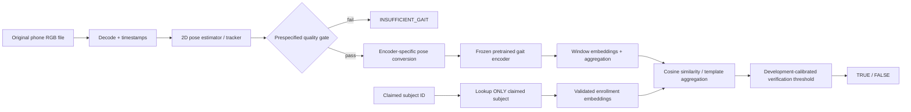

# Skeletal Gait Claimed-Identity Verification — Technical Product Requirements Document (PRD)

**Version:** 1.0 — 12 October 2026  
**Project phase:** Architecture implementation before new cohort collection  
**Status:** Implementation contract / experimental protocol; not a claim that any candidate model has been validated  
**Read together with:** [`GAIT_VERIFICATION_REARCHITECTURE_HANDOFF.md`](GAIT_VERIFICATION_REARCHITECTURE_HANDOFF.md)  
**Primary scope:** **1:1 claimed-identity gait verification only**. No 1:N identification.  
**Source of truth hierarchy:** Most recent explicit owner requirements > this PRD (implementation contract) > companion handoff (context and justification) > historical audits/research reports. Conflicts require explicit reporting, not silent reinterpretation.

---

## 0. Agent onboarding and no-regression contract

Before editing repository code in any gait-related task, the coding agent MUST:

1. Read `docs/gait_verification/GAIT_VERIFICATION_REARCHITECTURE_HANDOFF.md` and `docs/gait_verification/GAIT_VERIFICATION_TECHNICAL_PRD.md` **fully**, not only a summary or search snippet. If the actual repo uses another path, locate both by exact filename and report it.
2. Read relevant current repo source/configs/tests and reconcile any path or schema differences; **do not assume this PRD describes files already created**.
3. State in the working response: verification-only; claimed-person lookup only; TRUE/FALSE for usable, enrolled claims; explicit non-Boolean error/abstention statuses; E0 preserved; pretrained GaitPT and GPGait-family compared, not assumed superior; 40 people × 4 × ~30s planned, not collected.
4. Identify the phase, proposed edits, verification tests, assumptions, and blockers before making significant changes.
5. Preserve historical model and metrics. Implement new work additively and behind versioned flags/configs. Never delete historical baselines, caches, checkpoints or reports without explicit permission.
6. Avoid external-data or checkpoint downloads that need authentication, undisclosed licenses or unbounded disk usage. Report inaccessible artifacts as blockers. Log versions/checksums of downloaded artifacts.
7. Run available tests/smoke checks; disclose tests that could not run. Do not fabricate scores or model compatibility.
8. Update any relevant PRD change log / architecture decision record if task decisions change. Explicit new owner decisions require corresponding edits in **both** documents.

**Operational note:** `AGENTS.md` for Codex and `CLAUDE.md` for Claude Code provide automatic project-level routing; no repository instruction can literally guarantee an agent reads a long file before every substep. Use these instructions and a first-task readback as the practical safeguard.

---

## 1. Product definition, acceptance criteria and non-goals

### 1.1 Functional definition

Input: `(query_video, claimed_subject_id)` where `claimed_subject_id` is the ID of an already enrolled participant. Do not infer or change the claim from the video.

Processing: validate video; extract time-indexed 2D pose; assess quality; run a frozen pretrained pose-gait encoder using **checkpoint-native** skeleton conventions; pool to query embedding; retrieve **only that subject's** reference embeddings/prototype(s); score and compare with a threshold calibrated exclusively on development data.

Successful match response: `status=OK, verdict=true`. Reliable nonmatch response: `status=OK, verdict=false`. Other cases must use `status!=OK` and `verdict=null`; a quality failure is not a biometric mismatch.

**Hard prohibitions:** no 1:N top-match, `argmax` across identities, candidate list, Rank-1 output, gallery-wide score dump, unknown-person attribution, or assertion of synthetic manipulation. An enrolled-identity *storage index* is permitted for direct claimed-ID lookup; searching that store for nearest identity is not.

### 1.2 Structured inference contract (illustrative; adapt to current repo framework)

```json
{
  "schema_version": "gait-verification-v1",
  "request_id": "redacted-uuid",
  "claimed_subject_id": "S012",
  "status": "OK",
  "verdict": false,
  "decision_label": "CLAIM_NOT_SUPPORTED",
  "model_id": "gaitpt_grew_frozen_v1",
  "policy_version": "calibration_dev_v1"
}
```

Internal secure diagnostic result may additionally contain: `raw_similarity`, `calibrated_score` (only if genuinely fitted), `decision_threshold`, `quality_score`, `quality_failure_reasons`, `enrollment_template_count`, `pose_backend`, `model_checkpoint_sha256`, processing timings, original-take/derivative lineage IDs. **Do not return another identity or per-person matching rankings**. Exposing scores to an untrusted caller can enable probing of a biometric system; public APIs should minimize disclosures.

Supported status values:

| Status | `verdict` | Meaning | Caller action |
|---|---|---|---|
| `OK` | `true` or `false` | Usable gait, enrolled claim, thresholded comparison | Show **TRUE / FALSE** |
| `CLAIM_NOT_ENROLLED` | `null` | No valid approved enrollment for claimed ID | Enroll/request references |
| `INSUFFICIENT_GAIT` | `null` | Pose, coverage or motion inadequate | Recapture |
| `INVALID_INPUT` | `null` | Unsupported/truncated media or invalid claim syntax | Correct input |
| `PROCESSING_ERROR` | `null` | Model/decoder/system failure | Retry/investigate |
| `POLICY_NOT_READY` | `null` | Calibrated threshold or authorized model not installed | Configure development-derived policy |

A future `REVIEW_REQUIRED` status is optional only if explicitly approved. Do not convert quality or processing failures into `false`. Do not describe Boolean outputs as ground-truth identity certainty.

### 1.3 Acceptance criteria

- End-to-end verification supports arbitrary enrolled *claimed IDs* without a 13-class identification head or retraining each time a new identity is enrolled.
- When a query is compared to subject A, only subject A's templates are loaded for scoring. Integration test fails if another enrolled person's templates are used for that request.
- A genuine and a deliberately incorrect claim can be evaluated against the same query under controlled tests, with no leak of the walker's real ID into the inference path.
- At least one frozen published gait backbone produces deterministic, finite, dimension-checked embeddings on fixture samples using its **verified native input contract**. GaitPT first; GPGait++ or GPGait next if reproducible.
- Existing E0 benchmark code/checkpoints remain unchanged and runnable to the extent they were runnable at baseline; new comparisons share verification claim manifests, original sample identities and metric definitions.
- Raw and stabilized video derivatives have immutable source-file references; no dataset split includes descendants of one original on both training/development and locked-test sides.
- A quality failure yields `INSUFFICIENT_GAIT`, not a confident biometric rejection.
- Frozen-model baseline performs **no optimizer updates of the gait backbone**; verify weights/checksums or gradient-disabled state as appropriate.
- Thresholds and preprocessing/model selections are frozen before locked testing. Final metrics are **not available** until new data has been acquired and tested.

### 1.4 Out of scope

- 1:N person identification, ranking, gallery-wide nearest-identity search, unfamiliar-person labeling, open-set search thresholds.
- Pixel-level deepfake detection or forensic certification that manipulation occurred.
- On-device Android model inference, real-time streaming, continuous authentication, or biometric security guarantees without independent validation.
- Training large Transformer/GCN gait identity backbones from scratch on the 40-person study; unapproved whole-backbone fine-tuning.
- Camera-specific pose reconstruction from true metric depth; the planned acquisition is monocular RGB.

---

## 2. Existing baseline and compatibility boundaries

The historical repository audit (`CURRENT_ML_SYSTEM.md`, snapshot identified there) reports **13 people / 66 originals / 1,056 augmented derivatives / 1,120 feature-sequence entries**. Its shipped verification calculation comes from an approximately **133,058-parameter pairwise temporal Conv1D comparison head**. The fuller roughly 848K-parameter wrapper registers CNN/LSTM/Transformer modules but those components do **not** influence the audited decisive verification logits via the primary loss path.

Historical controlled E0 performance: ROC-AUC **85.24%**, EER **22.35%**, TAR@5% FAR **36.36%**. These are historical 13-person evidence, **not** a performance target or estimate for 40 new people. Legacy 94–95% AUC was computed under a different, more optimistic protocol and must not be directly contrasted with new session/view-held-out scores.

Relevant audited components to **inspect before reusing**, rather than assuming paths or methods still exist unchanged:

- `models/full_pipeline.py`, `models/verifier_variants.py`: original decision path / E0 variant.
- `utils/verification_harness.py`, `scripts/future_work/`: controlled trial, evaluation, calibration, robustness infrastructure.
- `utils/pose_backends.py`, `utils/pose_quality.py`, `scripts/future_work/extract_pose_cache.py`: full-rate tracking and pose quality infrastructure.
- `scripts/training/train.py`, `scripts/inference/inference.py`: legacy train/inference behaviors; **do not retain old identification/deepfake-like result labels in new endpoint**.
- `DOCUMENTATION/DATA_COLLECTION_PROTOCOL.md`, `scripts/future_work/validate_recordings.py`: prior acquisition plan/validator. Old minimum durations must be updated explicitly for proposed **~30s** capture rather than assumed authoritative.

Historical feature vector: 60 time steps × 78 channels (hip-relative coordinate features, six joint angles, adjacent pose-index differences). **New pretrained encoders MUST NOT consume these 78 channels unless their official input contract explicitly calls for them**. E0 may keep its old representation through a distinct baseline adapter. Preserve old code branch and result files without rewriting history.

---

## 3. Architecture candidates and experimental decision

### 3.1 Required comparative systems

| Candidate | Input | Local gait training initially | Output | Why |
|---|---|---|---|---|
| **E0 controlled pairwise temporal CNN** | Historical-compatible 78-D query and claimed template sequences | Retrain only where fair new-cohort split requires; original model code preserved | Pairwise verification logit/score | Strong, small historical baseline |
| **GaitPT frozen pretrained** | **Checkpoint-native** 2D skeleton sequence, source preprocessing | **None** | `d`-dimensional embedding, `d` measured at load | First implementation due to code/checkpoint availability |
| **GPGait++ frozen pretrained** | Native pose representation, Human-Oriented processing | **None** | Embedding output discovered at runtime | Strong published cross-domain challenger; weights indicated in official FastPoseGait repository; training code release incomplete |
| **GPGait frozen fallback** | Native Human-Oriented pose/gait pipeline | None | Embedding | Reproducible fallback if ++ inference cannot be established |

Other candidate paths (GaitGraph2, GaitFormer, SkeletonGait, GaitHeat, MotionBERT) are **future ablations**, not first-release dependencies.

Source checkpoints/encoder interfaces must be verified from actual official code and checkpoint rather than assuming dimensions and conventions from research prose. GaitPT papers report a 256-D representation and approximately 4M parameters, but the code must assert the **loaded artifact's** actual embedding shape. Do not hard-code 256 into core model-independent APIs.

### 3.2 GaitPT / GPGait integration readiness gate

Before allowing a backend to register as `READY`, document:

1. Official paper/repository URL, revision/commit, verified permitted-use license.
2. Actual checkpoint source, SHA-256 hash, download permission and presence of required weights.
3. Python/PyTorch/OS/CUDA/runtime dependency manifest.
4. Exact skeleton joint names/number/order, coordinate origin/reference, axis direction, scale, normalization, confidence handling and missing-joint semantics.
5. Expected `B × T × J × C` (or other) input and required number/selection of frames; valid gait windows; source FPS/temporal sampling and interpolation requirements.
6. Output layer/intermediate representation used as embedding, measured dimension `d`, pooling/normalization semantics and deterministic evaluation behavior.
7. One sample from **source dataset / published test pipeline** reproduces a valid forward pass before trying our phone videos.
8. At least one visually inspected pose conversion; mismatches must fail loudly, never silently invent joints.
9. Deterministic forward passes on the same input within reasonable floating-point tolerance.
10. Zero local backbone optimizer parameters in frozen run.

**No manual assumption that COCO-17 == source model 18-joint skeleton.** Where a source model requires a synthesized or additional joint, only apply an explicitly documented source-equivalent mapping and state its limitations. Otherwise mark the checkpoint incompatible until an evidence-backed adapter exists.

### 3.3 Architecture overview



Quality gating must not use ground-truth identity. Do not use `argmax` over subjects; when multiple templates exist, any `max`/top-k operation is **within the claimed person's enrollment only**.

---

## 4. Video ingestion and pose representation

### 4.1 Input media contract

- MP4/MOV and other decoder-supported containers. Validate stream count, width/height, timestamps, duration, frame count, corrupt/truncated content and decode errors.
- Study capture plan: **40 participants × four independent ~30-second videos** = **160 originals / ~80 minutes**. Views: `left45`, `right45`, `toward`, `away`. The **toward** and **away** setups may use a moving camera operator, not a static-camera benchmark.
- The dataset is **not yet collected**. Session count, oblique-camera movement, exact video resolution/frame rate and how many phone models are involved remain open collection questions; record actual values rather than fabricating them.
- Preserve file bytes and original presentation timestamps. Use `ffprobe` or equivalent to record codec, variable/constant frame behavior, nominal/average frame rate, size and recording parameters. Keep a source checksum and stable `original_take_id`.
- Prefer rear main 1× camera on OnePlus 11R for pilot; official specs document main-sensor OIS and EIS video support, 1080p/4K at 30/60 fps, **not** a guarantee that a mode can be toggled or produces suitable 2D gait tracks.
- Do not silently `setpts`, convert variable-frame-rate recordings to a fabricated uniform timeline, interpolate missing poses as if they were measured, or change physical-video order. Any normalized analysis derivative must document the transform and time mapping.

### 4.2 Multi-person and full-body handling

- Primary supported scenario is **one visible walker**. Reject or mark insufficient if persistent bystanders, person-switching, or multiple ambiguous tracks make subject assignment unreliable.
- Track stable person ID through sequence; cache bounding boxes and person-track continuity. Avoid choosing “biggest detection each frame” without temporal association.
- Feet/ankles/toes visibility is critical; center subject with margin for stabilization crop. Assess quality on the **actual analyzed derivative**, not only the raw input.

### 4.3 Pose cache schema (suggested, adjust current implementation)

```json
{
  "schema_version": "pose-track-v1",
  "original_take_id": "S012_left45_take01",
  "variant_id": "raw",
  "source_sha256": "...",
  "pose_backend_id": "rtmpose_modelhash_version",
  "joint_schema": "explicit_names_and_order_version",
  "frame_width": 1920,
  "frame_height": 1080,
  "timebase": "source presentation timestamps",
  "frames_uri": "pose_caches/...npz",
  "extraction_status": "OK"
}
```

NPZ/Parquet per-frame data: `source_frame_index`, `source_pts`/`timestamp_sec` (from actual stream), `track_id`, `bbox`, `xy[J,2]`, `confidence[J]`, `is_observed[J]`, any interpolation flags, and optional segmentation/quality traces. Cache full native detector joint set, then derive checkpoint-specific subsets. Include origin, transform, normalization and device revision in cache key.

### 4.4 Native pretrained preprocessing

Create `SkeletonContract` per encoder: source joint set → target joint set, axes, reference origin, normalization, sampling and missingness policy. Include tests using synthetic known-point examples (left/right shoulders and ankles must remain anatomically consistent). Visualize a converted overlay sample. Use the pretrained package's own preprocessing initially; only introduce alternate normalizations as separately registered ablations.

**WARNING:** For moving cameras, pixel motion is a combination of locomotion, camera translation/rotation, parallax and pose-estimation artifacts. Do not treat 2D hip displacement as unambiguous physical speed. Where velocity or cadence is computed, use measured timestamps `Δx/Δt` and interpret image-plane effects cautiously. The frozen encoder may keep source training's temporal normalization; don't rewrite its time convention just to accommodate a new side branch.

### 4.5 Quality gating

Candidate measurements, with thresholds chosen on independent development data:

- Valid frame/walk-window count and temporal coverage.
- Joint confidence distribution; fraction of missing/low-confidence ankles, knees, heels/feet where supported.
- Whole-body visibility, cropping at borders, minimum apparent person size and leg resolution.
- Track swaps, large bounding-box jumps, implausible bone-length variation, left/right swaps, jitter and occlusion.
- Abrupt camera movements and excessive rolling-shutter artifacts; detector performance under motion blur.
- Motion evidence sufficient to call sequence *walking* rather than merely static posture.

Avoid training a neural quality predictor from this dataset initially. Gate values are **provisional until pilot**, and abstention is a reported metric. No hidden exclusion of difficult videos without counting coverage loss.

---

## 5. Stabilization subsystem: supported methods, controlled experiments, and guardrails

### 5.1 Engineering policy

Stabilization is **not required by default**. Baseline = intact original file processed with normal camera behavior (including whatever main-camera OIS/firmware correction is unavoidable). New postprocessed videos are explicit `variant_id` derivatives of the same original. Raw images are immutable and should always remain available.

Two distinct camera problems:

- **High-frequency handheld shake**, often reducible with software smoothing or gyro-assisted compensation.
- **Deliberate camera translation following a subject**, which cannot be simply “stabilized away” without changing geometry; perspective/depth parallax and walking-induced forward/back camera motion still affect body projections.

No method can reconstruct occluded/cropped feet or reliably reverse strong motion blur. Aggressive stabilization/cropping can reduce useful joint pixels or introduce unnatural apparent joint trajectories. Best image appearance ≠ best biometric verification performance.

### 5.2 Candidate choices

| Mode | Suggested usage | Evidence/constraint |
|---|---|---|
| `raw` | **Mandatory control** | Original bytes, native camera output; avoids extra re-encoding |
| `stock_eis` | Optional matched pilot **capture mode** | OnePlus 11R documents EIS/Super Stable, but modes/crops vary by firmware, resolutions and phone UI; prior user test disappointing |
| `vidstab_mild` | **Primary repeatable postprocessed candidate** | FFmpeg two-pass `vidstabdetect` + `vidstabtransform`, scriptable for 160 files on Ubuntu |
| `davinci_translation` or `similarity` | Optional manual benchmark, difficult clips | Blackmagic manual distinguishes translation, similarity, perspective; avoid perspective warp initially because geometry matters |
| `shotcut_vidstab` | GUI front end to same class of `vid.stab` processing | Shotcut's Stabilize filter wraps vid.stab; useful when tuning visually |
| `gyroflow` | **Conditional advanced route** | Requires directly supported gyro video or correctly synchronized sensor logs and lens calibration. Standard OnePlus stock recording not known to contain Gyroflow-ready data. |

**Decision:** Record original with main-camera OIS (if enabled by phone naturally), conduct raw versus `vidstab_mild` development comparison. Optionally compare Resolve **Translation** or **Similarity**. Do not assume gyro-assisted stabilization is available; run a proof-of-compatibility capture/gyro experiment first. `Gyroflow` may be more powerful when synchronization/calibration works, not necessarily a practical one-week default.

### 5.3 FFmpeg two-pass example (per-video working directory)

Prerequisite: `ffmpeg -filters | grep vidstab` shows `vidstabdetect` and `vidstabtransform`; install an FFmpeg build with libvidstab if missing.

```bash
mkdir -p work/S012_left45 && cd work/S012_left45
ffmpeg -hide_banner -i /absolute/path/to/raw.mp4 \
  -vf "vidstabdetect=shakiness=5:accuracy=15:result=transforms.trf" \
  -an -f null -
ffmpeg -hide_banner -i /absolute/path/to/raw.mp4 \
  -vf "vidstabtransform=input=transforms.trf:smoothing=15:optzoom=1" \
  -c:v libx264 -crf 17 -preset medium -pix_fmt yuv420p \
  -an stabilized.mp4
```

These are **starter pilot settings, not the best scientifically proven settings**. `-an` suppresses audio **only in the analysis derivative**; the unmodified source preserves its audio. When audio is important for sync, use an explicitly documented copy/re-encode strategy. Re-encoding may change codec metadata and timestamp handling; validate source-to-derivative frame correspondence/PTS and do not infer physical time from nominal FPS alone. Keep the `.trf` file with the variant's pipeline manifest.

Do not reuse the `.trf` sidecar between different source clips. Avoid fast/slow temporal remapping, frame interpolation, motion deblur, temporal denoising, or per-identity stabilization selections in the primary experiment. Do not choose stabilization strength after inspecting locked-test labels.

### 5.4 Gyroflow investigation gate

The phone has a gyroscope (OnePlus specs), **but that alone does not establish stock MP4 includes gyro sensor tracks**. Gyroflow officially lists Android sensor/recording apps such as Sensor Logger and MotionCam Pro. Evaluate a controlled short recording with a supported capture/log pipeline only if willing to solve: gyro-to-video synchronization, camera-to-gyro orientation, lens profile/FOV calibration, rolling shutter, and potentially OIS/EIS interaction. Record outcomes `supported`, `incompatible`, `not validated`; do not build a required Gyroflow dependency without a successful proof.

### 5.5 Stabilization validation plan

Use 2–3 pilot participants (or a designated *development-only* subset of the 40) under all four views. Compare like-for-like processed derivatives of **the same original clips** (`raw` vs `vidstab_mild`), plus any optional capture EIS mode in additional matched takes. Evaluate:

1. Decoder/timestamp validity and output-frame correspondence.
2. Retained whole-body/foot coverage; crop fraction and apparent person size.
3. Pose detection rate, valid-foot fraction, keypoint confidence and stable tracking.
4. Anatomical temporal coherence: body-part jitter, bone-length stability, knee/ankle plausibility.
5. Pairwise verification scores/ROC/EER/TAR measured on development identities **with identical claim trials**; both enrollment and probe variants use controlled, documented preprocessing.
6. By-view performance and failures; compare `toward`/`away` versus left/right angles separately.
7. Runtime/storage costs, logs/checksums and batch repeatability.

Only promote stabilization if it gives a repeatable **end-to-end verification or strong pose-quality** improvement without damaging anatomy/coverage. Visual preference alone is insufficient. If `raw` performs as well or better, **use raw**. All transformations inherit source identity, session, split and capture metadata.

### 5.6 Stabilization evidence references

- OnePlus 11R India camera specs: https://www.oneplus.in/11r/specs (main camera OIS; 1080p/4K 30/60; EIS/OIS and Super Stable listed).
- FFmpeg/vid.stab official implementation: https://github.com/georgmartius/vid.stab ; FFmpeg filter docs: https://ffmpeg.org/ffmpeg-filters.html#vidstabdetect-1
- Shotcut Stabilize filter: https://forum.shotcut.org/pub/stabilize
- Blackmagic Resolve documented stabilization modes (Translation / Similarity / Perspective): https://documents.blackmagicdesign.com/UserManuals/DaVinci-Resolve-17-Editors-Guide.pdf
- Gyroflow and supported gyro sources: https://github.com/gyroflow/gyroflow

---

## 6. Encoder, aggregation, enrollment and claimed-identity scoring

### 6.1 Model interface (conceptual Python contract)

```python
from typing import Protocol
import numpy as np

class GaitEmbeddingBackend(Protocol):
    backend_id: str
    embedding_dim: int  # determined at runtime from checkpoint
    def encode_walk(self, pose_track: object) -> np.ndarray:
        """Return finite normalized float32 shape [embedding_dim]."""

class ClaimVerifier(Protocol):
    def verify(self, query_video: str, claimed_subject_id: str) -> dict:
        """Return only status + TRUE/FALSE (or null on non-OK)."""
```

A backend wrapper encapsulates checkpoint-specific pose preprocessing/window selection; it must **not** claim interchangeability of skeleton formats. Use injected extractor and template store dependencies so unit tests can run on synthetic poses.

### 6.2 Window and walk embeddings

For valid per-window embeddings `z_j` from *one original take*, normalize each and aggregate with prespecified quality weights `w_j`:

```text
u_j = z_j / (||z_j||_2 + eps)
u_walk = normalize(sum_j w_j * u_j / sum_j w_j)
```

Prohibit zero-norm, NaN/Inf, all-invalid or extremely short sequences. Store individual window scores/quality only in internal research artifacts; they do not create independent clips or identities.

### 6.3 Enrollment store and scores

Enrollment record: pseudonymous ID → authorized independent original take IDs → frozen pose/encoder/window recipe → embedding(s), per-view labels, quality and provenance. Store per-original walk embeddings. For an enrolled subject `c` the initial baseline prototype is:

```text
p_c = normalize(sum_{r in enrollment(c)} quality_r * u_r)
s(q,c) = dot(u_query, p_c)
```

Alternative development-only candidate rules:

- Mean score to the *claimed subject's* independent templates.
- Maximum cosine to the *claimed subject's* individual templates (requires a different calibrated threshold).
- View-aware centroid(s), **only within the claimed subject** and where enrollment supports it.
- Top-k average within claimed subject.

Do not compute similarity to other people in production inference. During **offline evaluation** the evaluator generates wrong claims by choosing enrollment IDs belonging to other test individuals. This is legitimate score-pair generation for measuring false acceptance; it must not add a search step to inference.

### 6.4 Thresholding and calibration

For quality-pass enrolled input, return `TRUE` iff `s(q,c) >= tau_ver`. Select **one global** threshold using held-out calibration/development subjects and the prespecified target operating point, not test subjects. When selecting TAR@FAR 5%, describe exactly how empirical FAR is estimated and any tolerance due to limited independent impostor subjects. Use EER only as a characterization; do not fit a threshold at test-set EER and then report same scores as prospective performance.

Raw cosine is a similarity, **not a posterior probability**. If probability is required internally, calibrate with a small logistic/Platt model on independent development claims and evaluate held-out calibration quality; with only ~40 subjects report uncertainty. Do not fit per-identity thresholds initially.

### 6.5 Local adaptation (optional later experiment)

Start with no trainable local encoder weights. If frozen transfer underperforms due to pose-domain mismatch, test `u' = normalize(u + alpha W2 GELU(W1u + b1) + alpha b2)` with `d → floor(d/4) → d`, residual initialized near zero. For a 256-D backbone this is `256 → 64 → 256`; 256→128→256 is only an alternative ablation, **not a fixed design requirement**.

Use support/query episodes with **different original takes** and subjects excluded from outer evaluation. Primary metric loss can be prototypical cross-entropy over cosine-to-support prototypes; optional supervised contrastive term is a secondary prespecified comparison. Never inadvertently select held-out test subjects as adaptation negatives or validation prototypes. Learning rates, temperature, epochs and adapter width must be tuned on development only. Freeze pose estimator and backbone initially; deeper unfreezing requires explicit evidence/permission.

---

## 7. New 40-person dataset specification

### 7.1 Proposed capture matrix

| Field | Planned value / rule |
|---|---|
| Independent identities | **Approximately 40**; actual count recorded, not promised |
| True original clips/identity | **Four** |
| Duration/clip | **Approximately 30 s** |
| Planned views | `left45`, `right45`, `toward`, `away` |
| Camera approach | Handheld Android; no gimbal currently; operator may move for toward/away |
| Full-body framing | Mandatory for usable recording: head to feet, shoes visible with safe margin |
| Footage total if complete | 160 originals; ~80 min |
| Session/day | **Not yet confirmed** — record actual day/session for every take |
| Movement instructions | Natural walking; do not over-script gait; label walking direction and camera motion |
| Filename / source ID | Stable pseudonymous subject ID, view, take, session |
| Privacy | Consent before capture, restricted name mapping and secure biometric storage |

**Important limitation:** one original per view does not create separate enrollment and probe takes **in the same view**. A 30-second file segmented into ten windows still counts as one original, one camera path and one occasion. Rotating which **entire view video** becomes probe tests cross-view/different-take transfer, not same-view independent-day robustness. If resources permit, an extra independent take for the same view and/or a later-day subset increases interpretability more than producing more augmentations of the same take.

### 7.2 Capture manifest required fields

`original_take_id, subject_id, session_id, date, view_label, viewing_angle_definition, walking_direction, camera_motion_mode, approximate_subject_distance_m, phone_model, camera_lens, resolution, nominal_fps, actual_frame_timestamps_ref, camera_settings, capture_stabilization_mode, duration_sec, source_file_uri, sha256, consent_ref, operator_id_pseudonym, recording_notes, quality_review_status`.

Consent/name mappings must live outside public repository. `operator_id_pseudonym` helps detect whether the same camera operator motion becomes correlated with certain subjects. Actual field names may be adapted to current code, but provenance functions must remain.

### 7.3 Subject, take and derivative partitioning

Keep subject-disjoint model selection and locked testing for **generalization to new enrolled identities**. Illustrative (not mandatory) split: 24 subjects for development/model selection, 8 for calibration, 8 locked final. Low subject count and 4 source takes each mean intervals will be broad and threshold estimates coarse; document selected split and random seed **before** final scores are seen. Nested subject folds across nonfinal subjects can make development more efficient.

Within every subject group, use one entire original as a probe and other independent originals as that subject's enrollment; rotate held-out view only within the assigned evaluation procedure. The probe and reference **must never come from the same original take**, including raw/stabilized/augmented descendants. For wrong-claim scores, use **only enrolled references belonging to a different subject**; do not let that different subject's videos change model parameters if it is part of locked evaluation.

If all subjects filmed on one day: the study supports cross-view/different-take claims and perhaps camera-motion stress tests, **not** long-term/session-invariant verification. Separately mark any later-day subset as an exploratory stress test unless the split was predeclared and protected. This limitation must be visible in paper, model card and teammate handoff.

### 7.4 Collection pilot gate

Before 160 production clips, record one small matched pilot using all four planned views, real phone settings and actual operator technique. Verify 30s continuous whole-body visibility, walking cycles, pose confidence, person track, foot stability, frame timestamps and safe camera motion. Keep pilot clips out of locked final evaluation if they guided acquisition settings. **For moving backward capture, use a clear hazard-free route and a spotter**; default to a stationary camera if backward walking cannot be performed safely.

---

## 8. Evaluation protocol and mathematics

### 8.1 Dataset unit and explicit trial manifest

The experiment's primary independent cluster is **person**, with `session_id` nested where genuinely different sessions exist. `original_take_id` defines source lineage; `query_window_id` is not an independent recording. Source derivatives inherit their parent's split.

Create a locked, immutable `VerificationTrialManifest` with one row per query-claim pairing:

```text
trial_id, query_original_take_id, query_variant_id, claimed_subject_id,
reference_original_take_ids, label_same_identity, probe_view, enroll_views,
query_session_id, fold_id, split_role, trial_policy_version
```

Positive label is `1` when query walker's identity equals the claim; negative label is `0` otherwise. Trial generation may know ground-truth body identity to assign labels, but **production verifier never receives it**. Do not overcount hundreds of cross-product impostor comparisons as independent participants; stratify or sample wrong claims in a prespecified deterministic procedure and retain full manifest.

### 8.2 Core verification metrics

For score `s` and threshold `tau`:

- `TP`: genuine claims accepted; `FN`: genuine claims rejected; `FP`: impostor claims accepted; `TN`: impostor claims rejected.
- `FAR = FP / (FP + TN)` for evaluable impostor claims; `FRR = FN / (FN + TP)` for evaluable genuine claims; `TAR = TP / (TP + FN) = 1 - FRR`.
- `ROC-AUC`: threshold-free separation, report alongside confidence interval.
- `EER`: descriptive crossover/interpolation of empirical FAR and FRR curves; do not select deployment threshold on locked-test EER.
- `TAR@FAR=5%`: developmental operating-point selection and test reporting with explicit empirical counting/discreteness and uncertainty.
- `Coverage = number status=OK / total submitted trials`. Report failure rates separately by claim class and view; rejection-only metrics **must not quietly exclude unusable probes** without reporting coverage.
- Runtime throughput per video; CPU/GPU peak memory; extraction failure frequency; pose-quality summaries.

For systematic model comparison, report **paired differences** on the same source query and claim trials, plus per-subject aggregate and subject-cluster bootstrap or paired resampling. If a metric can't be computed in a degenerate fold (all positives, no negatives, all abstentions), return an explicit `UNDEFINED_METRIC` reason, not zero or NaN silently.

**No longer primary metrics:** Rank-1, CMC, DIR/FPIR for 1:N identification, nearest-person rankings, identity retrieval accuracy.

### 8.3 Locked model-selection and threshold discipline

1. Fix all source recording IDs, subject splits and trial-construction version.
2. Establish E0 new-cohort controlled comparison (retrain on permitted development identities where needed).
3. Evaluate frozen pretrained GaitPT checkpoint sources and frozen GPGait++/GPGait on **development** folds only.
4. Evaluate any optional stabilization recipe, pose backend, enrollment strategy and adapter on development folds only.
5. Select candidate and score rule on development. Fit global threshold on designated calibration partition that did not choose the model, or use nested folds where sample size demands; report limitation.
6. Freeze complete artifact bundle: checkpoint hashes, preprocessing, quality gate, window sampler, reference construction, threshold, claim generator policy, source-split hash, code revision and environment.
7. Open locked final subject-group recordings **once**. Enrollment is permitted for held-out subjects using their separate reference originals, but they must remain unseen for tuning/adapter/threshold selection.
8. Publish genuine/impostor distributions, ROC, thresholded confusion counts, confidence intervals, coverage, per-view breakdown and runtime. Disclose lack of new-day repeat recordings if applicable.

Multiple checkpoint/pose/stabilization sweeps make overfitting to development likely; predeclare a small primary hypothesis family: (A) E0 vs GaitPT; (B) GaitPT vs GPGait-family; (C) raw vs mild stabilization. All other choices are exploratory unless separately controlled.

### 8.4 Fair model comparison requirements

All systems must see the **same identities, query originals, claimed IDs, reference-original sets, split assignments, and label definitions**. Preprocessing may differ **because official checkpoint input contracts differ**, but must be documented. An E0 trained on some new subjects versus a GaitPT externally pretrained on source populations is a legitimate operational comparison; state those training differences instead of pretending training regimes are identical.

For raw-vs-stabilized comparison, pair each source recording with its own derivative, vary one preprocessing element at a time, and recalibrate the affected score distribution using development data. Do not compare old 13-person AUCs directly to new 40-person AUCs as causal architecture gains.

### 8.5 Static appearance/morphology control

Where feasible, evaluate temporal shuffle or static averaged skeleton under **the same** encoder's input contract as a diagnostic to test whether identity evidence arises mainly from body proportions rather than dynamic gait. Avoid corrupting source preprocessing in a way that makes the control uninterpretable. A skeleton biometric can encode morphology; disclose this instead of claiming pure gait motion.

---

## 9. Module decomposition and planned repository layout

The following tree is **a proposal, not an assertion that these paths already exist**; adapt after repo discovery:

```text
docs/gait_verification/
    GAIT_VERIFICATION_REARCHITECTURE_HANDOFF.md
    GAIT_VERIFICATION_TECHNICAL_PRD.md
    architecture_decisions.md                 # optional later
AGENTS.md                                    # Codex, repository root
CLAUDE.md                                    # Claude Code, repository root
configs/gait_verification/
    capture_schema.yaml
    pose_backend.yaml
    models/gaitpt_grew.yaml
    models/gpgaitpp.yaml
    verification_policy.yaml
src/gait_verification/
    media.py                # decode + PTS + provenance
    pose.py                 # pose runtime and tracking
    skeleton_contracts.py   # exact checkpoint-specific mappings
    pose_quality.py         # quality / abstention signals
    backends/base.py        # embedding interface
    backends/gaitpt.py      # frozen native model wrapper
    backends/gpgait.py      # GPGait++ / GPGait wrapper
    embeddings.py           # window/walk aggregation
    enrollments.py          # claimed-person template store
    verifier.py             # one-person cosine + threshold
    stabilization.py        # variant management; no overwrite
    evaluation/trials.py    # deterministic verification-only manifest
    evaluation/metrics.py   # ROC/EER/TAR/FAR/FRR/coverage
    evaluation/runner.py    # comparable candidate orchestration
scripts/gait_verification/
    audit_checkpoints.py
    smoke_encoder.py
    inspect_pose_contract.py
    prepare_pose_cache.py
    enroll_subject.py
    verify_claim.py
    evaluate_claims.py
    stabilize_pilot.py
    validate_capture_manifest.py
tests/gait_verification/
    test_no_identification.py
    test_claim_only_enrollment.py
    test_split_lineage.py
    test_pose_contract.py
    test_embed_determinism.py
    test_quality_abstention.py
    test_metrics.py
    test_stabilization_variant.py
```

Preserve existing package conventions if different. Prefer a stable small public API over large refactoring. Add pinned dependencies only after testing official model version requirements; incompatible model packages may run in separately pinned environments for extraction/embedding so legacy E0 remains runnable.

---

## 10. Implementation phases, user stories, gates and deliverables

### Phase 0 — Build BEFORE new data (immediate; no new-cohort training)

**P0.1 Repo audit and preservation** — Snapshot versions and baseline results; inspect actual files; write a short repo-specific integration plan; create additive feature branch. Done when E0 files and tests remain intact and entry points are identified.

**P0.2 Checkpoint/source contract audit** — Verify GaitPT papers/repo/weights/license, run official preprocessor and source-sample inference, record actual tensor shapes and output embedding. Repeat for GPGait++ and/or fallback GPGait; do not pretend ++ is fully reproducible merely because weights are listed. Done when each supported backend is explicitly `READY` or `BLOCKED` with reasons and hashes.

**P0.3 Media/pose and cache** — Implement source timestamp preservation, person tracking, pose confidence, model-specific conversion, validation and provenance. Reuse existing full-rate pose-cache modules when appropriate. Done when an old walking video can produce reproducible cache + quality report without corrupting source.

**P0.4 Verification-only scoring** — Implement one-claim lookup, multiple reference embeds for only claimed person, cosine/prototype scoring, threshold status policy and explicit failures. Done when tests demonstrate no other identity ranking/search or disclosure and insufficient gait cannot return false.

**P0.5 Evaluator** — Build deterministic positive/wrong-claim trial generator, EER/TAR@FAR/ROC-AUC/FAR/FRR/coverage metrics and subject/take leak checks. Done when synthetic fixture datasets yield expected confusion-matrix metrics and errors on leakage.

**P0.6 Stabilization pilot plumbing** — Build derivative manifest and optional FFmpeg `vid.stab` runner with per-source sidecar paths; script A/B metrics. Done when one clip yields raw+stabilized variants with unique hashes, matching lineage and logged crop/pose effects; **no default stabilized-policy decision yet**.

**P0.7 Smoke tests / packaging** — Run verified backbones on existing 13-person clips only for engineering smoke checks or explicitly exploratory measurements. Provide CLI/demo accepting `(video, claimed_id)`. Done when packaging is reproducible and no final 40-person accuracy is asserted.

### Phase 1 — Capture pilot and recording SOP

Finalize operator movement, view-angle definition, recording mode, duration, camera distance, full-body framing and safe backward tracking. Test pose/stabilization quality on pilot clips. Freeze SOP. Re-record pilot participants if their first clips were unsuitable. Keep development-driven pilot identities out of locked final subject group.

### Phase 2 — Dataset ingestion

Receive ~160 originals; validate checksums/consent and file health; generate capture manifest; assign immutable splits; extract pose caches with raw and deliberately selected development variants. No original files overwritten.

### Phase 3 — Comparative verification baselines

Establish E0 on new data, then frozen GaitPT checkpoint variants and GPGait++/GPGait on the **identical** claim trial list. Report EER, TAR@5%, ROC-AUC, locked-threshold FAR/FRR, coverage and per-view/camera-motion effects. Pick a candidate using development data, then hold the chosen candidate fixed for calibration and final-test work.

### Phase 4 — Conditional improvements

Only if development evidence warrants: compare raw vs mild stabilization, alternative pose backend, view-aware vs global prototype, small adapter and possibly controlled morphology/dynamics side features. Re-evaluate model selection and thresholds without opening locked subjects. Escalate full-backbone tuning only by explicit decision.

### Phase 5 — Final evaluation and handoff

Freeze config/model/checkpoint/preprocessing/threshold/split hashes, evaluate locked subject group once, publish comprehensive metric/coverage and failure report. Handoff reproducible commands, manifests, trained adapters if any, licenses and security/ethics notes.

**No artificial deadlines or promised performance thresholds are authorized.** Code readiness and research validity are different milestones.

---

## 11. Detailed testing and quality gates

| Test | Expected behavior |
|---|---|
| Known genuine query and correct claim | Returns `status=OK`, Boolean verdict determined by calibrated score (do not hardcode TRUE for a fixture identity) |
| Known impostor query and wrong claim | Does not inspect or reveal the walker's actual identity; score against claimed enrollment only |
| Unknown claimed ID | `CLAIM_NOT_ENROLLED`, `verdict=null` |
| Invalid/corrupted video | `INVALID_INPUT` or `PROCESSING_ERROR`, `verdict=null` |
| Too few frames / missing feet / low pose confidence | `INSUFFICIENT_GAIT`, `verdict=null` |
| No threshold policy installed | `POLICY_NOT_READY`, `verdict=null` |
| Query clip reused as reference | Trial/enrollment builder rejects same `original_take_id` (including variants) |
| Stabilized child in different split than parent | Split validator hard-fails |
| Different input contract for backend | Model refuses input with actionable schema/pose mapping error |
| Failed pretrained weight loading | Backend marked unavailable; does not silently instantiate randomly initialized weights |
| Frozen run | Checkpoint remains unchanged; no optimizer/backprop to gait backbone |
| Repeated embedding on identical input | Deterministic output within defined tolerance |
| Query has 30-second duration | Produces valid per-window batch; no fixed 60-step assumption applied to new backbone |
| Every enrollment has four views from one day | Cross-view only; reporting forbids claiming multi-day generalization |
| Same trials across E0/GaitPT/GPGait | Trial IDs, labels, subject roles and original sources exactly match |
| Wrong-claim trial builder | Generates negatives only by substituting `claimed_subject_id`, not tampering with video ID |
| ROC/EER/TAR fixture | Matches known synthetic score/label example; handles ties and degenerate sets |
| Coverage report | Records all abstentions, including low-quality positives/negatives |
| Inference response logging | No identity ranking, no bystander private data, no plaintext secrets |

**Security:** pseudonymous identifiers, least-privilege access, secure consent records, encrypted storage where feasible, no unauthorized cloud uploads of biometric media, no public release of embeddings or raw faces without consent. This is experimental technology, **not** established high-security biometric authentication.

---

## 12. Agent instruction files and repeatable usage

### 12.1 Place files correctly

Commit the two docs in repository:

```text
<repository-root>/docs/gait_verification/GAIT_VERIFICATION_REARCHITECTURE_HANDOFF.md
<repository-root>/docs/gait_verification/GAIT_VERIFICATION_TECHNICAL_PRD.md
<repository-root>/AGENTS.md
<repository-root>/CLAUDE.md
```

The accompanying generated `AGENTS.md` and `CLAUDE.md` are ready-to-use minimal pointers. **Inspect existing versions first and MERGE, don't overwrite unrelated repository instructions.** Codex reads applicable `AGENTS.md` project instructions when invoked inside the repository. Claude Code loads project `CLAUDE.md` when run from the repository. Both instruction files direct them to the two long documents and require a readback before implementation.

### 12.2 Repeat this at the start of a substantive coding task

```text
Read fully and reconcile docs/gait_verification/GAIT_VERIFICATION_REARCHITECTURE_HANDOFF.md
and docs/gait_verification/GAIT_VERIFICATION_TECHNICAL_PRD.md first.
Confirm in your response: (1) 1:1 verification-only, (2) no identity search,
(3) TRUE/FALSE for usable enrolled claims; explicit abstention/errors otherwise,
(4) baseline E0 preserved, (5) frozen GaitPT then frozen GPGait++/GPGait,
(6) raw videos immutable and stabilization is an ablation.
Check actual repo, report contradictions, execute PRD Phase 0 step [X],
show changed files, tests and unresolved questions. Do not train yet.
```

If using ChatGPT Work/Codex cloud instead of local filesystem integration, explicitly make these two files and the actual source repository accessible to that working context; a link/attachment in an unrelated chat is not a guarantee of presence. Ask the agent to quote filenames/headings it read and repeat the hard non-goals. Stop a task if it claims to have read files but they are absent.

### 12.3 Optional executable guard

For high assurance, add a CI/script check that the two files exist, verify their SHA-256 against an approved docs revision, and require an explicit phase checklist (`P0.1` etc.) in the pull request. This **verifies file presence/version and process**, not that an LLM mentally read every sentence. A mandatory human review or approval gate is still the strongest guard for architectural changes.

---

## 13. Risk register and decision log

| Risk | Severity | Mitigation / required test |
|---|---|---|
| Domain mismatch between Android pose detector and external pretrained encoder | High | Strict joint/coordinate mapping audit; compare frozen backbones on development data |
| Camera translation confused with gait motion | High | Log `camera_motion_mode`, per-view breakdown and stabilization A/B |
| Feet cropped by stabilization zoom | High | Wide framing and retained-foot quality gate; reject aggressive crop |
| Enrollment/probe share one recording via windows or derivatives | Critical | Source-take lineage split validator; hard failures |
| New data all recorded in one session | High for external validity | State cross-view/different-take limitation; optional later-session subset |
| Low-quality probes automatically marked FALSE | High | Explicit `INSUFFICIENT_GAIT` status |
| Raw similarity called a confidence probability | Medium | Require calibrated model/label; show only Boolean public result |
| GPGait++ checkpoints inaccessible / training code incomplete | Medium | Frozen checkpoint smoke test; GPGait fallback; mark blocked clearly |
| Embedding dimension mismatch or fabricated joint mapping | High | Dynamic dimension introspection; documented contract and overlay test |
| 40 participants insufficient for precise low-FAR operational claims | High | Cluster uncertainty; report counts and empirical resolution |
| Existing E0 accidentally overwritten | High | Additive architecture branch and regression testing |
| Biometrics/privacy exposure | High | Consent, pseudonyms, access controls, retention policy, secure local processing |

**Confirmed owner decisions (12 October 2026):** claimed-identity verification only; no identity attribution; no gimbal; stabilization options to be investigated and empirically selected; ~40 participants and four ~30s capture views; implementation may start before collection.

**Pending decisions (should not block additive Phase 0):** exact capture phone(s), recording days, whether oblique angles use a stationary/moving camera, stabilization capture mode, permitted per-identity reference views, and final operating false-acceptance target.

---

## 14. Primary research and documentation references

**Internal:** `CURRENT_ML_SYSTEM.md`, `PLANNED_ML_SYSTEM.md` (historical context; superseded where inconsistent), `deep-research-report (1).md` (first gait architectural research), `Independent Reassessment and Final Architecture Selection for Small-Data Skeletal Gait Biometrics` (second report), companion handoff.

**Academic/source verification:**

- GaitPT (FG 2024): https://doi.org/10.1109/FG59268.2024.10581947 ; official code/checkpoints: https://github.com/UbiquitousCognitiveSystems/GaitPT
- GPGait (ICCV 2023): https://doi.org/10.1109/ICCV51070.2023.01795 ; FastPoseGait project: https://github.com/BNU-IVC/FastPoseGait
- GPGait++ (TPAMI 2025): https://doi.org/10.1109/TPAMI.2025.3577594
- Large-scale self-supervised skeleton gait research (AAAI 2026): https://doi.org/10.1609/aaai.v40i5.37340
- GaitGraph2: https://arxiv.org/abs/2204.07855 ; SkeletonGait: https://doi.org/10.1609/aaai.v38i2.27933
- MMPose pose-estimation library: https://github.com/open-mmlab/mmpose
- Prototypical Networks: https://arxiv.org/abs/1703.05175
- OnePlus 11R specs: https://www.oneplus.in/11r/specs
- vid.stab/FFmpeg: https://github.com/georgmartius/vid.stab
- Shotcut stabilization: https://forum.shotcut.org/pub/stabilize
- Blackmagic Resolve documentation: https://documents.blackmagicdesign.com/UserManuals/DaVinci-Resolve-17-Editors-Guide.pdf
- Gyroflow gyro-supported sources: https://github.com/gyroflow/gyroflow
- Codex repository instructions: https://github.com/openai/codex/blob/main/AGENTS.md and https://openai.com/index/unrolling-the-codex-agent-loop/
- Claude Code project instructions: https://support.claude.com/en/articles/14553240-give-claude-context-claude-md-and-better-prompts

---

## 15. Future amendments/change control

When owner explicitly changes a requirement: update PRD functional/nonfunctional requirements; update the companion handoff explanation, decisions and roadmap; revise affected configs/tests/recording SOP; and record the date/author/rationale/affected modules. If a requirement conflicts with scientific limitations, show both the product wish and the measurement caveat rather than quietly weakening the evaluation.

**Immediate handoff:** Build Phase 0 additive architecture with frozen gait backbones and claimed-identity scoring, run an actual four-view OnePlus capture/stabilization pilot, and reserve final architecture/stabilization/threshold decisions for new data.


## 16. Phase 0 change log — 12 October 2026

- **Explicit owner override (§5.3):** use detection
  `shakiness=5:accuracy=15:mincontrast=0.2` and transformation
  `smoothing=10:optzoom=0:crop=black:interpol=bicubic`. Smoothing 15 is an
  alternative ablation, still without automatic zoom. Prior example retained as
  historical context. Source PTS must survive encoding; V2 explicitly sets the
  encoder time base to the demuxed source (`-enc_time_base -1`).
- **Source-status correction (§3.1):** official FastPoseGait revision
  `d3ce631971a01d806eeb3a154774d482c0951813` contains GPGait++ model source and
  marks training-code release complete. This supersedes the earlier release
  assumption, without waiving source-sample/checkpoint/readiness gates in §3.2.
- **Response naming:** retain this PRD's `status=OK, verdict=true/false` and
  `CLAIM_NOT_ENROLLED` representation. The owner's Phase 0 request explicitly
  allows this detailed PRD contract in place of illustrative TRUE/FALSE/
  NOT_ENROLLED status strings. No identity-search outputs are added.

Author: Codex, implementing the owner's Phase 0 request. Changes affect the new
config, stabilization runner, model audit and tests only; historical E0 remains
unchanged. See [implementation report](PHASE_0_IMPLEMENTATION_REPORT.md).

## 17. Phase 1A owner scope and engineering amendment — 12 October 2026

Author: Codex, following the owner's Phase 0 independent-verification → Phase 1A
request. Phase 1A is RTMPose/runtime verification, temporal-window quality,
paired RAW/S10/S15 analysis and a capture SOP **draft**. GPGait++ integration,
training, calibration fitting and operational thresholds are excluded. The new
cohort and representative 30-second moving-camera pilot remain uncollected or
unprovided, and do not by themselves block implementation of this machinery.
A final SOP requires empirical four-view pilot evidence; it is not frozen now.

The existing detailed response contract remains: `OK` plus Boolean verdict,
`CLAIM_NOT_ENROLLED` (the owner's conceptual `NOT_ENROLLED`) or explicit error/
abstention plus null verdict. No identity search or deepfake attribution is added.

Native RTMPose SimCC confidence can exceed one and is not a probability. Preserve
finite nonnegative native scores without clipping. The native cache is extended
additively with detection counts, tracking events, image-quality proxies and
unassociated candidate poses; older caches remain loadable. Ambiguous people never
become an alternative identity output. Temporal diagnostics may tolerate isolated
missing frames, but encoder inputs remain unchanged fully observed contiguous
segments. Pooling across uncertain person tracks is refused. Window recipe hashes
bind the opt-in walk aggregation; the original Phase 0 gate remains available.
All quality constants in `phase1a.json` are provisional engineering heuristics.

See [Phase 1A report](PHASE_1A_CAPTURE_PILOT_REPORT.md) for independent Phase 0
verdict, measured CUDA/RTMPose evidence, paired results and limitations, and
[student recording draft](CAPTURE_SOP_DRAFT.md) for pending acquisition decisions.
These amendments supersede any earlier claim that a final capture SOP must already
be frozen at the end of this narrower engineering phase. E0 is unchanged.

## 18. Phase 1B model-integration change log — 12 October 2026

Author: Codex (interrupted), completed by Claude Code. Affected modules:
`backends/{checkpoint_extract,fastpose_contract,fastpose_infer_worker,fastpose_worker,gpgait}.py`,
`scripts/gait_verification/{extract_model_only,validate_model_integration,audit_checkpoints}.py`,
`configs/gait_verification/models.json`, `tests/gait_verification/test_phase1b.py`.

- **§3.1 status correction:** GPGait++ GREW is no longer blocked at checkpoint
  load. Its weights pass the §3.2 engineering items (hash, strict load, measured
  `d=4864`, determinism, frozen state). Source-sample reproduction (item 7) and
  readiness remain BLOCKED.
- **Checkpoint safety rule:** an official checkpoint that fails
  `weights_only=True` may only be reduced through a hash-pinned, human-reviewed
  static model-prefix audit (`AUDITED`), still deserialized by unchanged
  `weights_only=True`. Unrestricted loading and safe-global allowlisting remain prohibited.
- **Comparison rule:** each candidate keeps a separate model ID, recipe and
  training dataset. CASIA-B GPGait++ is excluded from the matched GREW-pretraining
  comparison unless a separate protocol is prespecified. Embeddings from different
  architectures are never pooled.

See [Phase 1B report](PHASE_1B_MODEL_INTEGRATION_REPORT.md).


## 19. Phase 1C enrollment/verification change log — 12 October 2026

Author: Claude Code. Affected: `enrollments.py`, `verifier.py`, `media.py`, new
`scoring.py`, `pipeline.py`, `registry.py`, `scripts/gait_verification/{enroll_subject,verify_claim}.py`,
`tests/gait_verification/test_phase1c.py`. E0 unchanged. See
[Phase 1C report](PHASE_1C_ENROLLMENT_VERIFICATION_REPORT.md).

- **§6.3 implemented:** one reference per independent original and per recipe
  (`enrollment-v2`); prototype derived on demand; alternatives (mean/max/top-2 mean,
  claimed subject only) exist as development-only strategies, none selected.
- **§1.2 status precedence fixed** (invalid input → store error → not enrolled →
  insufficient gait → runtime error → `POLICY_NOT_READY` → `OK`). **New engineering
  decision:** a probe whose recipe has no matching reference returns
  `CLAIM_NOT_ENROLLED`, not `POLICY_NOT_READY`.
- Scoring now runs before the policy gate so restricted diagnostics exist; the public
  result is unchanged and no threshold or policy is installed (`POLICY_NOT_READY`).
- Known limitation: an undeclared re-encoded/stabilized copy of an enrolled original
  cannot be detected from bytes; query lineage must come from the capture manifest.
